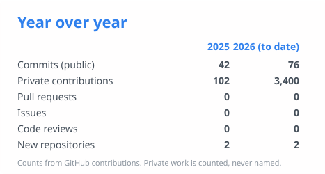
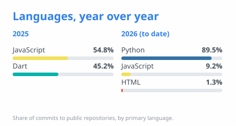

<h1 align="center">Issatay Massalin · istah</h1>

  Full-stack developer based in Romania. I turn manual business operations into reliable, tested software.

  <a href="https://balasana.kz">Balasana</a> •
  <a href="mailto:Massalin.issatay@gmail.com">Email</a>

## GitHub Snapshot

  
  

---

## Featured Work

**[Balasana](https://balasana.kz)** is a live booking and CRM platform for a yoga studio, used daily by clients and teachers in Kazakhstan, in Russian and Kazakh.

- Server-side booking and pass logic, QR check-in, waitlists, role-based admin
- Telegram bot with reminders, digests and alerts that cannot double-send
- A/B-tested student experience, Firestore rules covered by automated tests
- Tested before every release: lint, build and emulator checks gate each deploy

## What I Do

- Ship products from data model to production release
- Automate operations: bookings, notifications, reporting
- Secure and harden Firebase apps: roles, rules, App Check, backups
- Apply AI tooling to cut administrative work

## Tech

`Python` `SQL` `JavaScript` `Dart` · `React` `Vite` `Flutter` `Node.js` · `Firebase` `GitHub Actions` · `Telegram Bot API` `Claude Code` `MCP`

## Contact

Open to interesting problems: [Massalin.issatay@gmail.com](mailto:Massalin.issatay@gmail.com)
